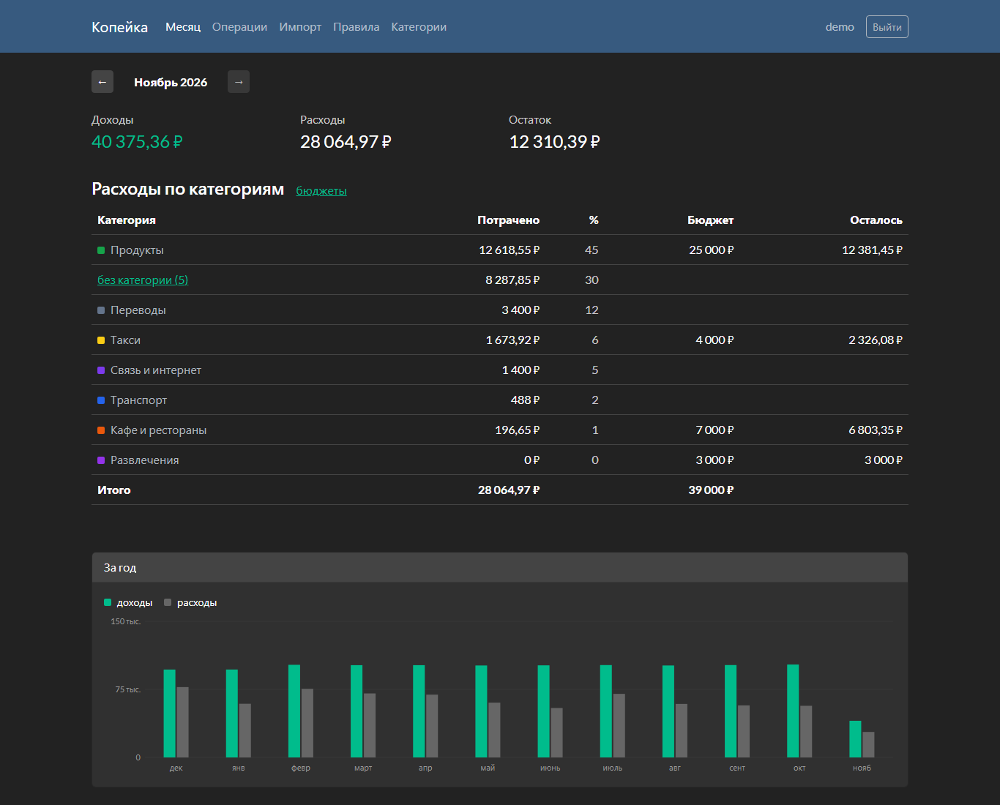
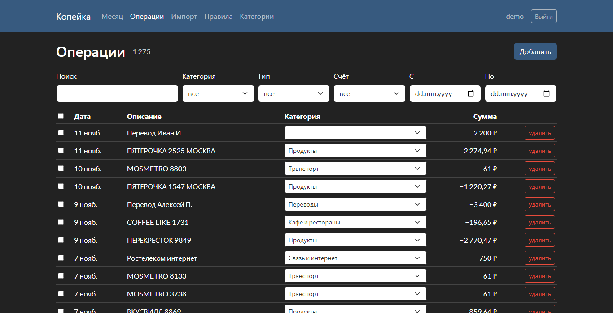

# Копейка

Учёт расходов по выпискам из банка. Загружаю CSV из интернет-банка, операции раскладываются
по категориям по правилам, которые задаю сам, и видно, сколько ушло за месяц и сколько
осталось по бюджетам. Раньше вёл это в таблице, надоело.



## Что есть

- импорт CSV (UTF-8 или cp1251, разделитель `;` или `,`), повторная загрузка того же файла не создаёт дублей
- правила: «описание содержит / начинается с / regex» и диапазон суммы, можно прогнать по всей истории
- категорию можно поменять руками, в том числе сразу у нескольких операций
- бюджеты на месяц
- отчёт за месяц и график за год



## Стек

Django, DRF, PostgreSQL, Redis (кэш отчётов), React, TypeScript, Vite, TanStack Query,
Bootstrap с темой Darkly из Bootswatch.
Тесты на pytest и vitest, в GitHub Actions гоняются линтеры и тесты.

## Запуск

```bash
docker compose up --build
docker compose exec backend python manage.py seed_demo
```

Открыть http://localhost:5173, логин `demo`, пароль `demo-password-2026`. `seed_demo` создаёт
полтора года тестовых операций. Пример выписки для импорта: `samples/statement_example.csv`.

Без докера: бэкенд без `DATABASE_URL` работает на SQLite, без `REDIS_URL` кэширует в памяти.

```bash
cd backend
pip install -r requirements-dev.txt
python manage.py migrate
python manage.py runserver
```

```bash
cd frontend
npm ci
npm run dev
```

Тесты: `pytest` в `backend`, `npm test` в `frontend`.

## Заметки

Дубли при повторном импорте ловятся по хэшу строки (дата, сумма, описание). Две одинаковые
покупки в один день дадут одинаковый хэш, поэтому к нему добавляется номер повтора внутри файла.

Поиск сначала сделал через `icontains`, но SQLite не умеет регистр для кириллицы. Завёл
отдельное поле `search_text` в нижнем регистре.

Применение правил ко всей истории сначала было на `bulk_update`, на ~40 тыс. операций выходило
около минуты. Переделал на `values_list` и один `UPDATE` на категорию, стало секунд 6.

## TODO

- импорт и применение правил в фоне (Celery)
- переводы между своими счетами сейчас считаются и расходом, и доходом
- только рубли
- e2e-тесты фронта
